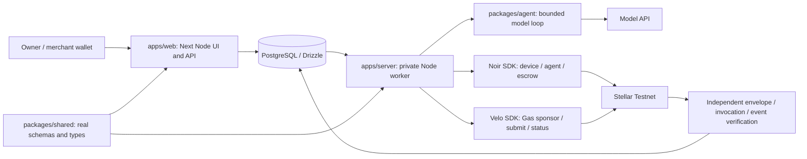

# AegisPay

A bounded agent that buys useful API reports for agent developers, with Noir spending limits and Velo-sponsored Stellar Testnet execution.

**Live website:** Not deployed; mandatory submission item outstanding.

**Demo video (2 min):** Not recorded or published; [recording script](docs/submission/recording-script.md).

**Pitch deck:** Draft [eight-slide source](docs/submission/pitch-deck.md); public Slides/Canva/PDF link outstanding.

**Team:** Salvador Vincent Javier (Discord handle not supplied).

Current implementation is an SDK spike with one verified payment and separate claim. The model loop, application, database, UI, real workspaces and hosting remain unfinished. The handbook deadline was Nov 7, 2026 at noon Philippine time and has passed; no extension was supplied and eligibility is not claimed.

## Problem

Agents need paid data while completing tasks, but developers must control what they can spend and verify that a purchase unlocks the intended resource. A payment status alone cannot establish the correct Noir invocation or a right to private data. AegisPay explores this workflow for agent developers and small API providers; customer demand remains unvalidated.

## Solution

The implemented spike proves a 0.03 Testnet XLM Noir escrow authorization sponsored and submitted by Velo, plus an over-cap contract simulation refusal and a separate merchant claim. The planned app adds a bounded model that chooses between two demo reports, immutable HTTP 402 quotes, durable payment recovery and resource-specific access. Reports are fictional fixtures; the linked Testnet transaction is real. This spike does not establish a completed model purchase or working website.

## How the agentic payment works

1. Owner registers a virtual device, sets a finite per-payment policy and funds Noir escrow; no NFC hardware is needed.
2. Planned F-005 model discovers QuickSignal (300000 stroops) and DeepTrace (1200000), chooses useful data and requests a real server quote. This autonomous loop is unbuilt.
3. Deterministic tools validate trusted terms, reserve budget and persist a strictly increasing nonce. The model cannot sign or change a price.
4. Noir SDK prepares one authorization. The server signs; Velo Gas reserves sponsorship, then submits that same signed invocation once. The spike implements this for 300000 stroops (0.03 Testnet XLM) to its configured merchant.
5. Velo success and independently matching envelope/invocation/event must agree. Planned DB entitlement is granted only then; unknown stays unentitled and recovery observes saved identity.
6. Authorization credits merchant-pending escrow. Merchant claim is separate and never creates another entitlement.

## Architecture



This is the selected target architecture, not a diagram of a deployed app. Existing spike adapters remain under `src/server/integrations/`; TASK-011 introduces the real workspaces before application work. [System design](docs/system-design.md) owns the mapping.

## Noir integration

- `@noirx402/agent-sdk` **0.3.0**, with `@stellar/stellar-sdk` **16.4.1**.
- Mandatory October 24 deployments: device_registry `CAC4KOLHDLDYDWBOKXNKRN5KVHO56PLOIFXDLTBUWGVN6GVDEB7FQHU5`; agent_registry `CCMZDSPTLX7IIJWCYEUM5DJUHOSOYSTHGK777S2TXZWEMC5ZZGPJ3EBV`; payment_escrow `CC7EAW5FNJEDBS7THM5IT6XIOHO4AOYMLXT3KSZ3HWUIKEACTW7E5BFS`. The handbook retires October 7 IDs; no custom deployment is used.
- `prepare` / `submit` with `registerDevice`, `registerAgent`, `fundEscrow`: [fixture provisioning](https://github.com/slvdrvncntjvr/AegisPay/blob/54ef3f0/src/server/integrations/spike-driver.ts#L44-L71).
- `checkPayment` and `prepare(... kind: 'authorize')`: [preflight/signing](https://github.com/slvdrvncntjvr/AegisPay/blob/54ef3f0/src/server/integrations/spike-driver.ts#L151-L174); direct Noir submission is used for owner operations and claim, not for the Velo-sponsored agent payment.
- `getDeviceOwner`, `getDeviceAgent`, `getPolicy`, `getEscrowToken`, `getEscrowBalance`, `getPendingBalance`: [confirmed reads](https://github.com/slvdrvncntjvr/AegisPay/blob/54ef3f0/src/server/integrations/spike-driver.ts#L51-L75).
- `prepare` / `submit` with `claim`: [separate merchant collection](https://github.com/slvdrvncntjvr/AegisPay/blob/54ef3f0/src/server/integrations/spike-driver.ts#L193-L200). [Independent verifier](src/server/integrations/stellar-evidence.ts) checks more than the event, which omits asset and agent.

## Velo integration

`@carts1024/velo-sdk` **1.0.0** supplies Gas sponsorship, submission and payment-status observation. [handoffOnce](https://github.com/slvdrvncntjvr/AegisPay/blob/54ef3f0/src/server/integrations/velo.ts#L42-L65) calls `gas.sponsor`, persists reservation identity and handoff, then `gas.submit` with automatic retries disabled. [Saved-identity recovery](https://github.com/slvdrvncntjvr/AegisPay/blob/54ef3f0/src/server/integrations/spike-driver.ts#L143-L181) uses `gas.getStatus` / `gas.waitForResult` and independent Stellar evidence.

No checkout or webhook integration is implemented or claimed. The handbook describes these as examples for other app parts; organizer-specific approval of Gas instead of checkout has not been supplied. Verified installed pins take precedence over the handbook's older alpha-tag example. An unrelated checkout would not prove Noir authorization.

## Testnet proof

One authorization of **300000 stroops (0.03 Testnet XLM)**, observed Nov 7, 2026:

- [Authorization fee-bump outer transaction](https://stellar.expert/explorer/testnet/tx/6e898ad830e866f0831577849361739cea7ad03cfbfcee9febf0fc057633d381).
- [Authorization inner transaction](https://stellar.expert/explorer/testnet/tx/1d39c3e3d7f400475aa2686f173a943346c5870635731fbd62fa41f1f912fa7a). These identify the same payment; the event reported the outer hash.
- [Separate merchant claim](https://stellar.expert/explorer/testnet/tx/94cea8bb561576ab71d4419571b92bd2fe7d8eada1273ff16960a716160c9a18).
- [Saved redacted report](docs/evidence/testnet/spike-c080d947-714b-43cf-92d0-ad9ed7c01439-1794062575156.json): escrow 10000000 → 9700000 stroops; merchant pending 0 → 300000 → 0. Two exported spike reports describe this same operation, not two purchases.

The over-cap 1200000-stroop refusal was actual deployed-contract simulation, unsigned/unsubmitted; it is not an included failed transaction. After both review fixes, 50 offline tests passed and integrated opt-in acceptance passed 51/51 with zero failures/skips. TASK-002 is complete. Independent outer-ledger and Velo fee both equal 82496 stroops; the same saved payment was observed without another handoff. The headless agent-key authorization is genuine; an autonomous model purchase and complete release are unproved.

## Repo structure

Existing folders: `src/server/integrations/` guarded spike adapters; `scripts/` runtime/setup/spike tools; `tests/testnet/` synthetic and opt-in tests; `docs/` specifications/evidence/submission drafts; `fmd/` documentation framework; `tools/` documentation checks.

Required target, not yet bootstrapped:

```text
apps/web/         Next Node frontend and authenticated API routes
apps/server/      Private Node worker and durable payment jobs
packages/agent/   Real model loop and tool implementation
packages/shared/  Real shared schemas and types
src/server/       Shared server-only domain/integrations retained initially
scripts/          Existing spike source kept stable
tests/           Payment, DB and browser checks (root folder:tests/)
docs/             Specs, redacted evidence and submission sources
package.json      Must declare workspaces in TASK-011; currently single package
```

Root workspace install must install all parts in one command; empty folders or documentation-only labels do not satisfy the requirement.

## Run it locally

1. Install Node **24.22.1**, Python 3 and pnpm **12.18.0**. Freighter and funded Testnet owner/merchant wallets are needed for the future app. Test XLM has no real value.
2. From the root run `npx --yes pnpm@12.18.0 install --frozen-lockfile`. This installs the existing harness; TASK-011 must extend the same root install to real workspaces.
3. Use [.env.example](.env.example) as the variable catalog. For the harness, `pnpm setup:spike` generates ignored `.env.spike.local`; fill the Velo Gas key locally. [Onboarding](docs/onboarding.md) documents funding/activation and guarded opt-in execution. For the future app copy only web-safe fields into `.env.local`, worker fields into `.env.worker.local`; never put agent/provider secrets in the web environment.
4. Available harness commands: `pnpm verify:sdk-imports`, `pnpm typecheck`, `pnpm lint`, `pnpm test:spike`. There is no working app start command yet. Future root `pnpm dev` / `pnpm worker` will launch the web/worker after migrations; do not treat declared build/test scripts as implemented application gates.

`RUN_TESTNET=0` is the persistent default. Explicit live fixture/spike commands can spend capped Testnet escrow and require enabled funded Velo access; read onboarding first. Never delete or reset saved operation identity to retry an unknown payment.

## Environment variables

No real secrets are committed. Every catalog name is listed below; process isolation details are in [onboarding](docs/onboarding.md).

| Name | What it is | Where to get it |
|------|------------|----------------|
| `NODE_ENV` | Process mode | Local/host runtime configuration |
| `APP_ORIGIN` | Expected public/web origin | Local URL; deployed URL after hosting |
| `DATABASE_URL` | Private PostgreSQL connection | Local Compose or managed PostgreSQL |
| `STELLAR_NETWORK` | Must be testnet | Fixed Testnet setting |
| `STELLAR_RPC_URL` | Testnet RPC endpoint | Official Stellar Testnet RPC |
| `STELLAR_NETWORK_PASSPHRASE` | Testnet passphrase | Stellar Networks.TESTNET |
| `NOIR_DEVICE_REGISTRY_ID` | Mandatory contract ID | October 24 handbook tuple and verified ledger reads |
| `NOIR_AGENT_REGISTRY_ID` | Mandatory contract ID | October 24 handbook tuple and verified ledger reads |
| `NOIR_PAYMENT_ESCROW_ID` | Mandatory contract ID | October 24 handbook tuple and verified ledger reads |
| `NOIR_XLM_SAC_ID` | Native XLM contract | Pinned SDK derivation, independently verified |
| `DEMO_OWNER_PUBLIC_KEY` | Public actor address | Corresponding funded Testnet wallet |
| `DEMO_AGENT_PUBLIC_KEY` | Public actor address | Corresponding funded Testnet wallet |
| `DEMO_MERCHANT_PUBLIC_KEY` | Public actor address | Corresponding funded Testnet wallet |
| `AGENT_SECRET` | Worker-only constrained Testnet signer | Locally generated disposable agent |
| `VELO_GAS_API_KEY` | Worker/spike-only Gas Testnet key | Velo project Gas Station dashboard |
| `VELO_GAS_BASE_URL` | Gas service origin | Verified Velo deployment configuration |
| `ANTHROPIC_API_KEY` | Worker-only model credential | User model-provider account; access unverified |
| `AGENT_MODEL` | Configured model identifier | Verified provider catalog and access smoke test |
| `ENVELOPE_ENCRYPTION_KEY` | Worker/spike-only 32-byte encryption key | Local secure random generation |
| `DEMO_OWNER_LOGIN_TOKEN` | Web-only role login secret | Independent secure random generation |
| `DEMO_MERCHANT_LOGIN_TOKEN` | Web-only role login secret | Independent secure random generation |
| `RECEIPT_SIGNING_KEY` | Shared server-side receipt HMAC key | Independent secure random generation |
| `RUN_TESTNET` | Explicit live-test guard; default 0 | Per-process opt-in only |
| `SPIKE_OWNER_SECRET` | Spike-only disposable signer | Local setup:spike; never web/normal worker |
| `SPIKE_MERCHANT_SECRET` | Spike-only disposable signer | Local setup:spike; never web/normal worker |

## Screenshots

No product UI screenshots exist. The application UI is unbuilt; diagrams and linked chain artifacts are available above. Capture actual hosted policy/run/audit/claim screens after release gates; label fixtures and saved runs visibly.

## What's next

Bootstrap real workspaces (TASK-011); implement DB/payment recovery/model/UI (TASK-003 through TASK-010); deploy and verify the working public app (TASK-012); publish video/deck and validate submission links (TASK-013). [Implementation plan](docs/implementation-plan.md) owns status. F-005 remains a real LLM requirement. Missing inputs include verified model access, hosting configuration, public app/video/deck URLs, Discord handle and registration confirmation. Late submission acceptance and Gas interpretation remain external questions; no eligibility or win is promised.

## Credits

Built by Salvador Vincent Javier with AI coding assistance. Uses Noir, Velo, Stellar SDK/Testnet/Friendbot, Next.js, React, TypeScript, PostgreSQL, Drizzle, Zod, Tailwind, Anthropic SDK, Freighter and the FMD documentation framework; see [pinned dependencies](package.json) and [research](docs/research.md). No commercial partnership, security audit or x402 conformance is claimed. Event facts derive from the user-supplied Builder Handbook, updated Nov 5, 2026; [provenance](docs/research.md#builder-handbook-reconciliation--2026-11-07) records its basename and SHA256 without distributing the ignored PDF.
