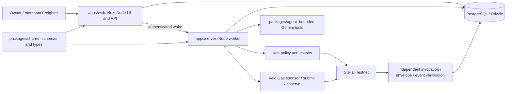

# AegisPay

A bounded agent payment experiment: immutable API quotes, Noir spending policy, Velo sponsorship and independently verified Stellar Testnet evidence before protected report access.

- **Public saved proof:** [aegispay-live.vercel.app](https://aegispay-live.vercel.app), replaying one historical SDK authorization and separate claim.
- **Authenticated preview:** [aegispay-auth-preview.onrender.com/app](https://aegispay-auth-preview.onrender.com/app). Private owner/merchant access; Nov 11 qualification excluded model and financial execution. Nov 14 anonymous health/login/console checks pass and protected APIs return401; current authenticated qualification remains open.
- **Video:** [112-second recorded evidence replay](docs/submission/aegispay-demo.mp4). A completed live model-purchase recording remains outstanding.
- **Deck:** [public eight-slide PDF](https://github.com/slvdrvncntjvr/AegisPay/blob/main/docs/submission/AegisPay-pitch-draft.pdf).
- **Team:** Salvador Vincent Javier; Discord/registration confirmation remains external.

The application, four workspaces, PostgreSQL persistence, bounded Gemini loop, authenticated console and human-wallet APIs are implemented. **Full live demo readiness is incomplete.** Provider tool connectivity now passes; actual app-model choices, wallet lifecycle, two distinct application purchases, refusal/recovery evidence and hosted worker qualification remain release gates. See the [current wallet recovery](docs/evidence/wallet-recovery-2026-11-14/report.md), [independent hosted database](docs/evidence/hosted-release-2026-11-14/report.md), [earlier local wallet setup](docs/evidence/live-setup-2026-11-14/report.md), [earlier readiness report](docs/evidence/demo-readiness-2026-11-14/report.md) and [task ledger](docs/implementation-plan.md).

## Implemented behavior

Owner Policy/Run/Audit and merchant Pending/Offers/Claim screens use authenticated APIs. Merchant edits affect future prices; accepted quotes stay immutable. Amounts are integer stroops. The worker persists reservation identity before its single submission boundary; unknown outcomes stay held and unentitled. Protected reports require matching Velo execution and independent Noir envelope/invocation/event evidence. Merchant claim is separate.

Freighter actions require explicit human review and the configured Testnet signer. Reclaim checks revocation and rejects unresolved purchases; pending reclaim also blocks new purchases. Durable wallet observation jobs use saved hashes, lease fencing and authenticated wake. Only an exact independently included failed human-wallet transaction can terminate as failed; ambiguous data stays unknown. Synthetic local tests do not establish live acceptance.

Nov 14 Gemini readiness: the initial smoke timed out; one later opt-in timing diagnostic completed the configured `models/gemini-3.5-flash` tool roundtrip (two POST200, exit0). Call identity and thought signatures were preserved. Configuration stayed unchanged and zero financial actions occurred. Actual app-model price/no-purchase/purchase acceptance remains open.

## Architecture



[System design](docs/system-design.md), [API](docs/api-spec.md) and [security](docs/security-compliance.md) own the contracts. Render is the selected Free hosting target. The isolated worker needs authenticated HTTPS wake and durable SQL recovery. The deployed console preview has no financial/model worker credentials; complete hosted release is not qualified.

## Testnet proof

One genuine **300000-stroop (0.03 Testnet XLM)** authorization from Nov 7:

- [Outer fee-bump transaction](https://stellar.expert/explorer/testnet/tx/6e898ad830e866f0831577849361739cea7ad03cfbfcee9febf0fc057633d381) and [inner transaction](https://stellar.expert/explorer/testnet/tx/1d39c3e3d7f400475aa2686f173a943346c5870635731fbd62fa41f1f912fa7a) identify the same purchase.
- [Separate merchant claim](https://stellar.expert/explorer/testnet/tx/94cea8bb561576ab71d4419571b92bd2fe7d8eada1273ff16960a716160c9a18).
- [Verified redacted report](docs/evidence/testnet/spike-c080d947-714b-43cf-92d0-ad9ed7c01439-1794064999769.json). Actual Velo/ledger fee: 82496 stroops. Multiple exports do not count as distinct purchases.

The historical over-cap refusal occurred in deployed-contract simulation, unsigned and unsubmitted. It is not an included failed transaction. Separate Nov 9 application attempt `f69178b7-0b0b-46fa-8e82-65c2dd5deee5` remains unknown, reserved and unentitled. No resend, nonce reset, reclaim or hold release is authorized.

Pinned Noir **0.3.0**, Stellar SDK **16.4.1** and Velo **1.0.0** use the mandatory October 24 contracts verified by the spike. No custom deployment, mainnet, checkout substitution or x402 conformance is claimed. [Integration source](src/server/integrations/) and [research](docs/research.md) provide details.

## Run and verify

Use Node **24.22.1**, Corepack pnpm **12.18.0**, Python 3 and Docker Desktop for isolated PostgreSQL **17.11**. From the repository root:

```text
corepack.cmd pnpm install --frozen-lockfile
corepack.cmd pnpm db:setup
corepack.cmd pnpm typecheck
corepack.cmd pnpm lint
corepack.cmd pnpm test:unit
corepack.cmd pnpm test:integration
corepack.cmd pnpm test:spike
corepack.cmd pnpm build
python tools/check-docs.py
python fmd/tools/check-implementation-plan.py docs/implementation-plan.md --strict
```

Where pnpm is on PATH, `pnpm` is equivalent. `db:setup` preserves its ignored configuration and starts only the workspace-owned Docker DB. Integration tests use fresh UUID-owned schemas in distinct loopback `aegispay_integration`; never aim them at financial state.

Use [.env.example](.env.example) as a variable catalog. Web configuration belongs in `apps/web/.env.local` or an isolated process environment; root `.env.worker.local` is loaded only by scripts that name it. Agent/provider/encryption keys stay worker-only; login secrets stay server-side. [Onboarding](docs/onboarding.md) covers startup and consent.

`corepack.cmd pnpm dev` starts web; `corepack.cmd pnpm worker` starts payment/model/wallet consumers. Starting a funded worker can execute existing jobs: review its isolated context and per-process permission first. Generated persistent configuration defaults to `RUN_TESTNET=0`. That flag does not disable saved-identity observation or manually approved human-wallet actions.

Browser tests need a separately started production web process, `UI_BASE_URL` (default `http://127.0.0.1:3017`) and installed Chromium. Run `corepack.cmd pnpm test:e2e --workers=1`. Protected API transport is intercepted; this is not live acceptance.

## Command boundaries

| Command | Evidence scope |
|---------|----------------|
| `test:spike` | Offline SDK/journal safeguards |
| `test:testnet` | Opt-in historical spike acceptance, not complete app release |
| `demo:smoke` | Inert default; `--offline` is synthetic model/tool/DB coverage; `--model-only` is stub offer choice |
| `node --import tsx scripts/model-smoke.ts --worker-env-file .env.worker.local` | Bounded provider tool roundtrip, no DB/payment access |
| `node --import tsx scripts/release-rehearsal.ts` | Inert, exit 2; explicit independent manifest/phase required |

The new release runner has diagnostic preflight/wallet reads, a durable zero-budget app-model phase, identity-only verification and a disabled purchase mode. Its live phases were **not run** in this checkpoint. Automated purchase execution is disabled pending durable exact-price/deadline authority; existing manual app acceptance still requires fresh explicit consent in an independent context. [Runner limits and manual steps](docs/evidence/demo-readiness-2026-11-14/rehearsal.md).

## Delivery status

[QA](docs/qa-test-plan.md) owns release requirements. The [historical checkpoint](docs/submission/final-checkpoint.md) remains dated history; the current report owns present observations. Free staging PostgreSQL expires **2026-12-10T11:55:40.452333Z**. Supplied evidence records Nov 8 Top15 selection; finals logistics remain TBA. The original Nov 7 deadline has passed; no extension, late acceptance or organizer-specific Gas interpretation is asserted.

Built with Noir, Velo, Stellar, Next.js/React, TypeScript, PostgreSQL/Drizzle, Gemini, Freighter and FMD. Reports are fictional fixtures. Demand and sustainable economics remain unvalidated.
